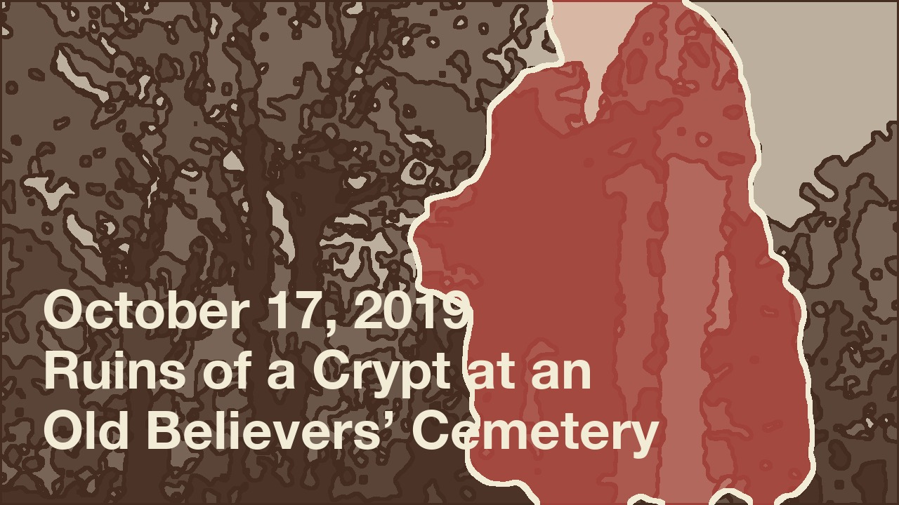
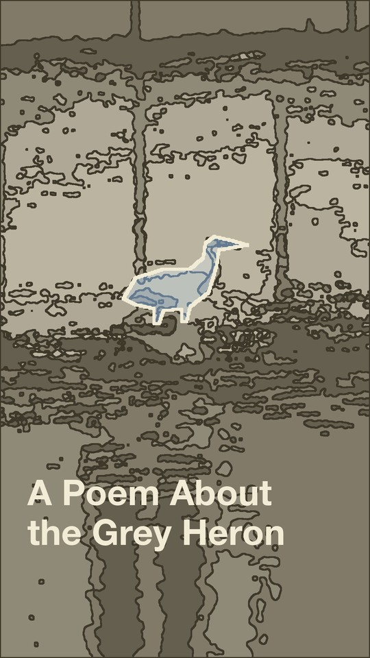

# contour-video-covers

Covers for music videos, made from the video itself: one frame is redrawn as a
**contour field** (a few flat tones with ink lines on the tone borders), and one
object — the **hero** — keeps its own colour and a thin light edge. The title
sits on a fixed grid. That is all.



This is the tool behind the cover system of my YouTube music channel. The
story of how the style was found — about 150 variants in seven directions — is
on Behance:
[What the Clip Remembers](https://www.behance.net/gallery/256475761/What-the-Clip-Remembers-Music-Channel-Cover-System).
The covers live on [youtube.com/@matyushkin](https://www.youtube.com/@matyushkin).

## Install

```sh
git clone https://github.com/matyushkin/contour-video-covers
cd contour-video-covers
uv sync
```

The title is set in Helvetica Neue Bold, which ships with macOS. On other
systems pass any bold font with `--font`.

## One cover

```sh
uv run contour-cover make examples/crypt-frame.jpg \
  --crop 0,0,1600,900 \
  --hero-box 700,0,1450,900 \
  --neutral 52,26,16 --accent 153,51,43 \
  -t "October 17, 2019" -t "Ruins of a Crypt at an" -t "Old Believers’ Cemetery" \
  -o out/crypt.jpg --check
```

- `frame` — one frame from the video (export it with ffmpeg or take a screenshot).
- `--crop` — the part of the frame to use, in frame pixels. Without it the
  frame is cropped to the centre.
- the hero, one of three ways, in frame pixels:
  - `--hero-box x0,y0,x1,y1` — a rough rectangle; the object inside is cut out
    automatically (GrabCut). Good for a large hero on a calm background;
  - `--hero-polygon outline.json` — a list of `[x, y]` points traced by hand.
    Use it for small or thin heroes (a bird, a person far away);
  - `--hero-mask mask.png` — a ready black-and-white mask of the frame's size.
- `--neutral R,G,B` — the dark colour of the field. Take it from the clip's own
  palette. Without it the tool guesses one from the frame.
- `--accent R,G,B` — the hero's colour. Without it the tool takes the hero's
  own hue; check the guess, it can drift (a brick-red ruin came out orange).
- `-t` — one title line; repeat for more lines. Break long titles by meaning.
- `--dark-title` — dark title for a light field (snow).
- `--vertical` — a 1080 × 1920 cover for Shorts.
- `--check` — also writes `*-mask.png` (the hero alone) and `*-small.png`
  (the cover at real playlist size, 168 × 94).

## A series

Keep all covers of a channel in one JSON file and render them together, or
only the ones you change:

```sh
uv run contour-cover batch examples/covers.json -o out --check
uv run contour-cover batch examples/covers.json -o out --only crypt
```

See [`examples/covers.json`](examples/covers.json): a horizontal cover with a
box hero and a vertical Shorts cover with a hand-traced hero.



## The grid

Only the title is fixed; everything else comes from the clip.

| | Horizontal 1280 × 720 | Vertical 1080 × 1920 |
|---|---|---|
| Typeface | Helvetica Neue Bold | Helvetica Neue Bold |
| Size / line gap | 76 / 86 px | 104 / 116 px |
| Left edge | 60 px | 80 px |
| Baseline of the last line | 640 px | 1590 px |
| Hero edge | 7 px | 9 px |

The last line always sits on the same baseline, so a long title grows upward.
One size for every cover: never shrink a long title or grow a short one.

On Shorts the shelf crops a vertical cover to about 2 : 3, so keep the title
and the hero between y = 150 and y = 1770.

## Rules

1. **One hero** a viewer could name after watching: a ball, a whale, a heron,
   a ruin, a ship. It must read at 168 × 94 px.
2. **Its colour comes from the clip**, never from a fixed palette. Neighbouring
   covers should not share an accent.
3. **The field's dark colour comes from the clip** too: graphite, deep teal,
   rust brown, night blue.
4. **Neighbouring covers differ** in the hero's shape and place: round next to
   long, tall next to small.
5. **Keep the hero clear of the title** where the frame allows; if it must
   pass behind the text, let only its edge touch the title block.
6. **Check the mask on its own** before looking at the cover. Automatic
   selection often takes a neighbour along — a sunlit patch of wall the colour
   of the hero, a strip of sky. Trace small heroes by hand.
7. **Check the cover at 168 × 94** next to the others.
8. No artist name, taglines, arrows, outlines or plates behind the text.

When the clip is only a face sung to camera, there is no object to keep. Draw
the hero from the lyrics as a real, textured object, make a mask for it and
pass it with `--hero-mask`.

## Licence

Code: MIT. The example frames and covers in `examples/` are from my own videos;
please do not reuse them.
